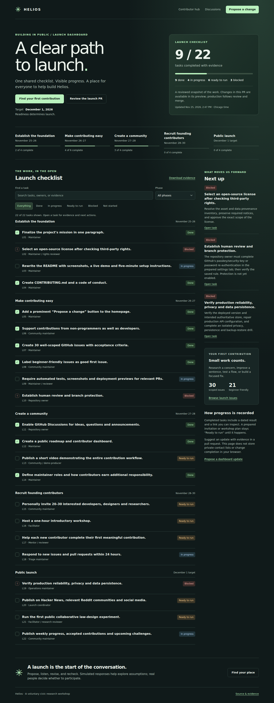
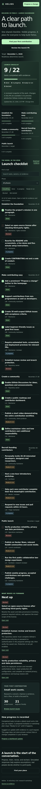

# Helios AI

Helios is a collaborative civic research workshop where people turn everyday concerns into proposals, compare evidence and simulated scenarios, and improve drafts together. Our mission is to make the path from “I have an idea” to a clear, reviewable contribution understandable and useful for citizens, researchers, designers, and developers. Participation is voluntary, people retain control over what they share, and human review determines what enters the project; simulated responses are tools for exploring assumptions and never stand in for real people's consent.

**[Live demo](https://helioshtml.com/) · [Launch dashboard preview](https://deploy-preview-108--heliosailol.netlify.app/launch) · [Contribution hub preview](https://deploy-preview-108--heliosailol.netlify.app/contribute) · [Good first issues](https://github.com/adnanwahab/HeliosHTML/issues?q=is%3Aissue+is%3Aopen+label%3A%22good+first+issue%22) · [Contributing](CONTRIBUTING.md)**

## Start with one useful contribution

Open the demo and choose **Propose a change**. Write the problem, the change you would like to try, and how you would tell whether it helped. Review the text before sharing it. The GitHub route lets you open a proposal pull request using GitHub's own editor; it requires a GitHub account, but you do not need to install developer tools or create a Helios account.

You can also contribute a source-backed research note, an objection to a proposal, a design sketch, an accessibility review, a reproducible bug report, or a code change. Pick one of the [30 starter issues](https://github.com/adnanwahab/HeliosHTML/issues?q=is%3Aissue+in%3Atitle+%22Launch%3A%22). Each has acceptance criteria; 21 are labeled `good first issue`. See the [first-contribution walkthrough](CONTRIBUTING.md#your-first-contribution-without-a-terminal).

Helios is an independent experiment. Its proposals are drafts, and its participation features are advisory. Deployed environments have different storage capabilities; a homepage loading successfully does not verify that a public submission will persist. See the [launch evidence dashboard](https://deploy-preview-108--heliosailol.netlify.app/launch) before planning a public event.

## Launch dashboard

The dashboard tracks the 22 launch tasks, with an owner, next action, and evidence for each. Completed work is distinguished from prepared materials and unresolved launch gates. Updating the versioned checklist in a reviewed PR keeps the page, progress count, and review record aligned. Target launch: **December 1, 2026**, subject to the remaining gates.

[Open the dashboard preview](https://deploy-preview-108--heliosailol.netlify.app/launch). The dashboard foundation landed in [PR #75](https://github.com/adnanwahab/HeliosHTML/pull/75). [PR #108](https://github.com/adnanwahab/HeliosHTML/pull/108) adds the tutorial, screenshots and latest evidence; use its preview to review that work.



<details>
<summary>Mobile dashboard</summary>



</details>

These screenshots were captured from PR head `2eaab74` in the [desktop/mobile capture run](https://github.com/adnanwahab/HeliosHTML/actions/runs/45698534055). Their progress count is a dated snapshot; the live dashboard carries subsequent updates.

### Watch the contribution workflow

[Watch the 96-second captioned walkthrough](https://deploy-preview-108--heliosailol.netlify.app/launch#workflow-video), or read its [transcript and capture notes](public/launch/contribution-workflow-transcript.md). It covers choosing a task, drafting, reviewing public text, opening a GitHub proposal, PR evidence, automated checks, human review, and recording completion. Real app captures use fictitious input; later GitHub steps are clearly labeled instructions, and no demonstration proposal was published.

## Five-minute local setup

Prerequisites: Git, [Node.js 22 or newer](https://nodejs.org/), and [Bun 1.3 or newer](https://bun.sh/). CI currently requests Bun 1.4.2. The five-minute estimate starts after installing those prerequisites; dependency downloads vary with your connection.

```sh
git clone https://github.com/adnanwahab/HeliosHTML.git
cd HeliosHTML
bun install --frozen-lockfile
bun run dev
```

Open **http://127.0.0.1:3000/**. To review this launch PR before it is merged, run `git switch feat/contributor-launch` after cloning, then visit **http://127.0.0.1:3000/launch** or **http://127.0.0.1:3000/contribute**. If the remote branch was not fetched, run `git fetch origin feat/contributor-launch` and `git switch --track origin/feat/contributor-launch`.

A fresh local checkout uses PGlite in `.data/pglite` when `SUPABASE_DB_URL` is unset. You do not need Supabase, paid model APIs, GitHub credentials, or production secrets for local development. Keep inherited production environment variables out of the development shell. The first start creates the local database; wait for the terminal's server-ready message. Stop it with `Ctrl+C`. To use another port, run `PORT=3001 bun run dev` in a POSIX shell.

### Check a change

```sh
bun --no-env-file test
bun run build
# Browser tests also need Chromium (one-time installation):
bunx playwright install chromium
CI=1 bun run test:browser
```

The browser suite starts its own server on port 3101 and uses a temporary database. CI also checks a Fly-like container and captures desktop/mobile screenshots. Include an exact feature preview URL, validation results, and screenshot evidence in every relevant PR. See [CONTRIBUTING.md](CONTRIBUTING.md) and [AGENTS.md](AGENTS.md).

## What you can explore

| Experience | Start here | What it shows |
| --- | --- | --- |
| Civic workshop | `/` | Express a concern, develop a proposal, inspect revisions and advisory feedback. |
| Consensus World | `/public/consensus-world` | Revise a draft and compare synthetic responses under explicit assumptions. |
| Contribution hub | `/contribute` | Paths for research, design, testing, documentation, and code contributions. |
| Launch dashboard | `/launch` | Evidence and remaining work for the 22 launch checklist items. |
| Editorial law atlas | `/laws` | Proposed goals, scenario assumptions, revision review, and environment-dependent shared features. |

The contribution hub and dashboard foundation were merged in [PR #75](https://github.com/adnanwahab/HeliosHTML/pull/75). Current evidence and tutorial improvements are in [PR #108](https://github.com/adnanwahab/HeliosHTML/pull/108). Other experiences and implementation details are cataloged in [the archive](docs/experiences.md) and [implementation notes](docs/launch/implementation-notes.md).

### Example: address the strongest objections

For a Backyard Homes and Affordable Housing Pilot Act, a useful contribution might be a stronger safeguard rather than a new feature:

| Potential objection | Proposed compromise |
| --- | --- |
| Neighborhood overcrowding | Limit the initial pilot to one additional home per eligible property |
| Increased property taxes | Require a transparent assessment of tax impacts before enrollment |
| Flooding and drainage | Require drainage and infrastructure capacity checks |
| Loss of privacy | Establish reasonable setbacks and privacy standards |
| Expensive implementation | Publish a capped pilot budget |
| Government overreach | Keep participation voluntary |
| Benefits mainly wealthy owners | Include affordable financing options for eligible lower-income homeowners |

These are candidate objections and compromises to investigate, not measured public opinions. Record the evidence, affected groups, costs, remaining disagreement, and exact revision being reviewed. The [first collaborative experiment](docs/launch/community-operations.md#first-public-collaborative-law-design-experiment) turns this example into a facilitated session.

## Project map

| Path | Purpose |
| --- | --- |
| `index.html`, `public/` | Browser experiences, client behavior, and public assets. |
| `src/` | API behavior, storage adapters, and server-side integrations. |
| `data/catalog.json` | Bundled editorial proposal catalog. |
| `netlify/`, `netlify.toml` | Netlify functions and routing. |
| `scripts/` | Build, local server, deployment checks, and visual capture. |
| `test/` | Bun unit/integration tests and Playwright browser tests. |
| `docs/` | Feature, operational, and launch documentation. |

For backend setup see [backend documentation](docs/backend.md). For preview review see [PR visual previews](docs/pr-visual-previews.md). For persistence and recovery checks see [data safety and launch](docs/data-safety-and-launch.md). Public proposal text, private journal content, browser practice data, and simulated votes have different handling requirements; preserve those boundaries when changing a feature.

## Community and launch operations

Read the [first public progress report](https://github.com/adnanwahab/HeliosHTML/issues/109) and join the [Backyard Homes design experiment](https://github.com/adnanwahab/HeliosHTML/issues/107). The experiment is open for voluntary responses; a published draft does not establish public agreement.

Read the [code of conduct](CODE_OF_CONDUCT.md), [maintainer roles and progression](GOVERNANCE.md), and [public roadmap](docs/contributor-launch.md). The [community operations kit](docs/launch/community-operations.md) contains the invitation, one-hour workshop, onboarding process, demonstration script, launch posts, and weekly report template. Prepared materials are not evidence that invitations were sent, an event happened, or a report was published.

The first-maintainer-response target is **within 24 hours**. The process is documented; actual response-time compliance is measured from real issue and PR activity. Moderation coverage, review permissions, and operational readiness remain visible launch gates until verified.

## Licensing

**MIT is the candidate for original project code. The repository does not yet have a project-wide license.** The initial [rights audit](docs/launch/license-audit.md) identifies third-party images, geographic data, downloaded sitemaps, external libraries, fonts, and model assets that need provenance and notice review before that license can be applied safely. Follow [issue #99](https://github.com/adnanwahab/HeliosHTML/issues/99) for the remaining work.

Only submit material you have the right to contribute, and include the origin and terms of third-party work. Public source visibility is not a blanket license for every asset; [GitHub's licensing guide](https://docs.github.com/en/repositories/managing-your-repositorys-settings-and-features/customizing-your-repository/licensing-a-repository) explains the distinction.
