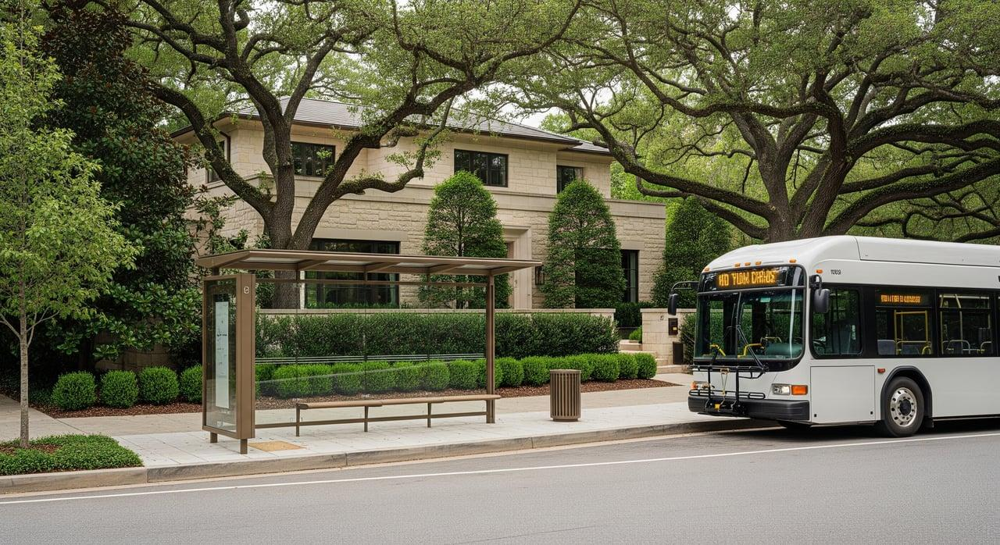

# Helios.AI


please use https://greydanus.github.io/2026/11/12/pengpt/ to make a signature.

# We welcome contributors
pls edit the readme and then we will regenerate the html.

## Consensus World — bill revision workshop

Open [Consensus World](https://helioshtml.com/public/consensus-world) and select **Improve draft bill** or, after a completed round, **Address remaining objections**. Choose revision modes, generate a local draft or explicitly opt into the configured AI provider, edit the proposed text and policy assumptions, then keep the revision. Unrun originals are retained locally in the draft archive, separate from completed simulations. Complete the original round first to compare exactly the same population, seed and simulated day. The quick preview evaluates 10,000 matching synthetic IDs; it is not a survey. Diagnostics report the lowest weighted contribution among non-yes agents, not actual people's reasons. A high score does not demonstrate real consent or policy effectiveness.

### Example: Backyard Homes and Affordable Housing Pilot Act

| Potential objection | Proposed compromise |
| --- | --- |
| Neighborhood overcrowding | Limit the initial pilot to one additional home per eligible property |
| Increased property taxes | Require a transparent assessment of tax impacts before enrollment |
| Flooding and drainage | Require drainage and infrastructure capacity checks |
| Loss of privacy | Establish reasonable setbacks and privacy standards |
| Expensive implementation | Publish a capped pilot budget |
| Government overreach | Keep participation voluntary |
| Benefits mainly wealthy owners | Include affordable financing options for eligible lower-income homeowners |

These are candidate objections and compromises to investigate, not measured public opinions. Review evidence and unresolved trade-offs before changing model assumptions.

Local drafting is available without login or API configuration. Local modes use templates; custom prompts need manual edits or the optional AI provider. To enable the Netlify AI endpoint, set `CONSENSUS_AI_ENABLED=1` and a secret server-side `OPENAI_API_KEY`; optionally set `OPENAI_MODEL` (defaults to `gpt-4.1-mini`). This is a paid feature and is disabled by default; use provider spend limits before enabling it publicly. Each request requires explicit consent, sends only the draft, instructions and aggregate diagnostic context, and uses `store:false`. Rate limits are best-effort per warm function instance, not a global quota. No key is sent to the browser. AI responses are suggestions, not legal advice or votes.


**First-time participants:** [Start here](https://helios-ai-laws.fly.dev/welcome) to explore editorial draft goals, private demo notes, and optional public proposals/amendments. These are not government ballots.

**Maintainers:** [Data safety and launch checklist](docs/data-safety-and-launch.md) covers Fly volume snapshots, isolated persistence tests, and careful participant onboarding. The production Fly volume must never be replaced to run tests.

Helios merges everyone's jorunal ammendment to a consitution.

1. new bus stop to french place
2. pls make a bridge from new york to france
3. +100b in r and d



# Implementation time from months to 10 minutes
# Communication time from months to 1 second
# 90% of people just want 1 screen -> experts have another one

3. "Eight billion minds. One shared conversation about the future."

# find friends - peopel who vote like you 

not everyone has polticial expertise but everybody probably has good ideas for a better world
so we use tranformer APIs to convert your idea to a law that people want to implement
and then decision makers and political experts in capitols approve or give feedback thanks.

Our goal is to support all governments and all leaders and all citizens.

learning synthesis

Leaders deserve to smoke more weed - so this apps supports all governments and companies etc.

# Incentives for voting
$1 a day + bonuses for cool ideas.


# What if humanity could think together?
flowchart TB
    subgraph Users["Users / Citizens"]
        U[Browser]
    end

    subgraph Helios["helios-ai-laws.fly.dev<br/>+ heliosHTML (Civic Pulse)"]
        direction TB
        H_Shell[Helios Shell / Tabs<br/>Landing · Unified · Goals · Pulse]
        H_Journal[Private Journal Vault<br/>consent-first, localStorage<br/>theme / excerpt / full grants]
        H_Cluster[Topic Clustering<br/>& Representative Briefs]
        H_Draft[Living Constitution<br/>Drafts · Amendments · Daily Summary]
        H_Unified[Unified Embed<br/>Universe · Lab · Futures · Bills]
        
        H_Shell --> H_Journal
        H_Shell --> H_Cluster
        H_Shell --> H_Draft
        H_Shell --> H_Unified
    end

    subgraph Civic["Civic Synthesis<br/>(dear_congress prototype)"]
        CS_Journal[Journal Ingestion]
        CS_Needs[Need Extraction<br/>& Needs Graph]
        CS_Vote[Open-ended Voting<br/>& Scoring]
        CS_Synth[Synthesis Engine<br/>→ Packages<br/>Balanced / Minimal / Popular]
        CS_Plan[Plan + Legislative Handoff JSON]
        
        CS_Journal --> CS_Needs --> CS_Vote --> CS_Synth --> CS_Plan
    end

    subgraph HBL["HappyBearLandia<br/>happybearlandia.fly.dev"]
        HBL_World[World / Living City<br/>3D + Simulation]
        HBL_Const[Constitution City<br/>/visualize-constitution]
        HBL_Decision[Decision Studio]
        HBL_Future[Future Machine<br/>paired baseline vs plan]
        HBL_Lab[City Systems Lab]
        
        HBL_World --> HBL_Future
        HBL_Const --> HBL_Future
        HBL_Decision --> HBL_Future
    end

    %% Primary data flows
    U -->|interact| H_Shell
    H_Journal -->|explicit grant<br/>excerpt / theme only| CS_Journal
    H_Unified -->|Enter / Shift+Enter<br/>or dedicated send| HBL_World
    H_Draft -->|published plan / clause| CS_Plan
    CS_Plan -->|load plan| HBL_Const
    CS_Plan -->|load plan| HBL_Decision
    HBL_Future -->|simulation results<br/>WHY traces| H_Unified
    HBL_Future -->|simulation results| H_Draft

    %% Iframe / embed boundaries
    H_Shell -.->|iframe| H_Unified
    H_Shell -.->|iframe or route| HBL_World
    H_Shell -.->|iframe or route| HBL_Const
    H_Unified -.->|sends to| HBL_World

    %% Styling
    classDef helios fill:#e4f6f1,stroke:#0b9d8a
    classDef civic fill:#fff4e6,stroke:#edb55d
    classDef hbl fill:#e8f0fe,stroke:#1a73e8
    class Helios,H_Shell,H_Journal,H_Cluster,H_Draft,H_Unified helios
    class Civic,CS_Journal,CS_Needs,CS_Vote,CS_Synth,CS_Plan civic
    class HBL,HBL_World,HBL_Const,HBL_Decision,HBL_Future,HBL_Lab hbl


Artificial intelligence is advancing at extraordinary speed. But intelligence alone doesn't tell us what kind of world to build.

Every day, billions of people have ideas, frustrations, hopes, and solutions that never reach the institutions shaping their lives.

HELIOS changes that.

A private journal becomes an invitation to participate. Ideas people choose to share become collective understanding. Collective understanding becomes proposals, decisions, and measurable progress.

**The future of intelligence should be shaped by the people it serves.**

20 journals → 20 possible changes
What someone writes in their journal	What HELIOS proposes
🚌 "Please put a bus stop near my house."	Neighborhood Mobility Act — Improve transit access in underserved neighborhoods.
🌉 "Build a bridge from New York to France."	Transatlantic Connection Initiative — Study radically better ways to cross oceans.
🏡 "My rent is too expensive. I want to live near my friends."	Affordable Homes Initiative — Make it easier to build homes where people want to live.
🌳 "I wish every street had trees."	Green Streets Initiative — Expand neighborhood shade and urban forests.
🐕 "I want to bring my dog on the bus."	Pet-Friendly Transit Pilot — Test safe, accessible pet policies on public transit.
🍕 "Everyone should get free pizza on Fridays."	Community Meals Pilot — Test neighborhood gatherings and shared meals.
💻 "I wish everyone could learn to code for free."	Universal Learning Initiative — Expand free access to digital education.
❤️ "I'm lonely. I wish there were somewhere to meet people."	Third Places for Everyone Act — Create accessible public spaces for friendship and community.
🏥 "My mom waited six months to see a doctor."	Timely Healthcare Access Initiative — Reduce unreasonable delays in essential care.
🧠 "I want an AI that remembers everything I learn."	Personal Knowledge Freedom Act — Give people control over portable, private AI memory.
🚲 "Cars drive too fast near my school."	Safe Streets Initiative — Improve pedestrian safety around schools.
🌊 "My street floods every time it rains."	Flood Resilience Initiative — Upgrade drainage infrastructure where risks are highest.
🧑‍🚀 "I want to visit the Moon someday."	Space Access Initiative — Support safe, increasingly accessible space exploration.
🗳️ "I don't know what my mayor voted for yesterday."	Transparent Government Act — Make public decisions easy to find and understand.
🏖️ "I wish I had more time with my family."	Work-Life Balance Initiative — Explore shorter workweeks and flexible work arrangements.
🧬 "Why can't scientists share their discoveries for free?"	Open Science Initiative — Expand public access to publicly funded research.
🎮 "I want to explore my city 100 years in the future."	Public Simulation Initiative — Let communities explore possible futures before making policy decisions.
🌍 "I wish I could talk to anyone, regardless of language."	Universal Translation Initiative — Expand access to multilingual communication tools.
🧪 "I want a communal science lab in every city."	Public Science Labs Initiative — Establish shared spaces for experimentation and invention.
🕊️ "Why can't countries solve disagreements without wars?"	Peaceful Cooperation Initiative — Strengthen international conflict prevention and mediation.

"Today I got rejected from an apartment by an AI. Nobody could tell me why. I couldn't even talk to a human.

I don't think computers should be allowed to make important decisions about our lives without explaining themselves.

Maybe everyone should have the right to ask why?"


Helios HTML is a ice cream model. It's sole purpose is to create new flavors of ice cream.!
Ice cream tastes good when you smoke weed. I highly reccomend this.

Helios AI is a civic tool that reads what everyone in a community says they need and groups the needs people share, like safer crossings or later clinic hours. It then drafts a plan in which every line links back to the needs behind it, so you can always see why it says what it says. Helios drafts and revises, but people vote, and nothing becomes the plan without their approval.

## What's in this repo

- `index.html` — Front-page 100-law atlas with interactive per-law scenario charts, version-scoped advisory voting and proposed updates via the Supabase backend; three-lane constitution workbench with live typing, deduplicated sample clauses, advisory votes and moderated comments; Helios Loops: citizen (express → synthesize → decide) and government preview (understand → evaluate → respond → measure). Private journal text stays in the page; public proposal submission is explicit; preview positions and government feedback stay local.
- [Archived experiences](docs/experiences.md) — the former multi-tab dashboard and demo routes, accessible through the top-right **Docs** tabbed iframe viewer (with a compact drawer) and footer archive link without cluttering the main workflow.
- `helios_ai_landing_page.html` — the Helios AI landing page
- `helios_hippie_landing.html` — HeliosAI hippie-style landing page ("8 billion people, one big circle")
- `helios_fork.html` — Fork Helios page with GitHub fork button, setup instructions and static preview (`/embed/fork`)
- `world_plan_simulator.html` — World Plan Simulator: a synthetic year of daily journal pages from 8.2 billion people, turned into needs, a plan and a regional vote (served at `/embed/world-plan`)
- `vote_radar.html` — Vote Radar: a radar-style dot map of the US where a 24-hour sweep lights up simulated daily votes state by state, with a day per ballot, a live feed, callouts for needs, consensus and dissent, and running totals. Sample data, not an official ballot (served at `/radar` and `/embed/radar`)
- `eight_billion_map.html` — Eight billion people, five laws: a deck.gl map that gives each person one response per law, with area shading and a sample of individual dots (served at `/eight-billion`). Laws, population and thoughts are synthetic placeholders, not polling data.
- `three_editor_merge.html` — Three-editor merge: two journals on the sides, the constitution merged from them in the middle with duplicates removed, and an infinite scroll over 8 billion sample journals generated in the browser (served at `/merge` and `/embed/merge`; [S3 layout](docs/journal-merge-s3.md))
- `helios_100_frontend_demo.html` — 100 Shared Goals demo, with estimated arrival dates for each goal ([assumptions](docs/arrival-estimates.md))
- `heliosai_acts_orbit.html` — Acts in Orbit: all 111 HELIOSAI acts in one list, with a draft Universal Basic Income Act at #1, as a three.js solar system and D3 circle-pack, ranked by importance or shuffled (served at `/embed/orbit`)
- `support_every_country.html` — Support Every Country: all 195 flags (the 193 UN members plus Vatican City and Palestine) waving one at a time under "Support <country>", with a custom message, seconds per flag, region filter, shuffle and a searchable wall of every flag (served at `/flags` and `/embed/flags`; images in `public/flags/`)
- `neighborhood_consensus.html` — Neighborhood Consensus: a liquid 3D surface of how support for a local proposal spreads across a neighborhood, by blocks from the site and by week, with a cooperation view, a replayable sweep and five linked charts (map, time, turnout, across-blocks, all proposals). Sample ballots for a made-up neighborhood, not real votes; you can paste your own ([docs](docs/neighborhood-consensus.md); served at `/consensus` and `/embed/consensus`)
- `long_coil.html` — The Long Coil: technology from 3.3 million BCE wound into a 3D coil, one loop per century, then projected ten years ahead to 2036. Each projected milestone names the plan, roadmap or trend it rests on and a confidence tier; forecasts made in the past are checked against what happened, and a ledger view lists everything as tables. The record of about 500 sourced entries is inlined in the page (served at `/coil` and `/embed/coil`)
- `helios_notion_preview.html` — the plan as a Notion document, synced through the Notion API ([docs](docs/notion.md))
- `helios_braindance.html` — Braindance: Mirrorworld Pensieve. Key events from Nov 2019 to Nov 2033 around a mirror line at 23 Nov 2026: recorded events on a 3D globe above a pensieve surface, scheduled, planned and projected ones on its reflection below, with a weekly calendar grid, a time scrubber and a searchable log of every event. The event records live in the page and `bun test` checks them (served at `/braindance` and `/embed/braindance`; three.js loads from jsDelivr)
- `helios-unified.html` — Helios Unified (Universe · Communal Science Lab · Futures)
- `communal_science_lab_webgpu (1).html` — the Communal Science Lab (WebGPU)
- `sunshine_breakfast.html` — Sunshine for Breakfast: a PS1-style Three.js scene where the dialogue moves one line per scroll step, with original characters and dialogue (served at `/embed/sunshine`)
- `public/eight-billion-five-laws/` — Eight Billion, Five Laws: a deck.gl map of 2.1 million sampled dots, each standing for about 3,815 people, with one simulated response per law (served at `/public/eight-billion-five-laws/`). Laws, thoughts and population are synthetic placeholders, not polling data.

## Running locally

```sh
bun install
bun run dev
```

Then open http://localhost:3000/ or http://localhost:3000/laws. Without `SUPABASE_DB_URL` the dev server keeps the 100 goals, proposals and amendment history in a local PGlite database (`.data/pglite`). Browser-local demo notes remain local. See [backend and deployment documentation](docs/backend.md) for the API, the Supabase database, the Netlify functions and the SQLite migration.


-----------ideas_
I would create **The World Commons** — a democratic institution that countries voluntarily participate in every week through a journaling app.

Its central idea:

> **Every person deserves a voice. Every country deserves a seat. Every week, humanity should understand itself a little better.**

I would call the evolving record of shared agreements **The Living Accord**, rather than a constitution.

The goal isn't to create a world government. It's to create a trusted global conversation that makes cooperation easier.

## **1. The institution**

# **THE WORLD COMMONS**

A weekly democratic conversation for humanity

**Millions of personal journals**

People describe their experiences, concerns and hopes

**HELIOSAI synthesis**

Translate, identify common ground, preserve disagreements

**Citizens + country representatives**

Deliberate independently and recommend action

**The Living Accord**

A public, versioned record of voluntary agreements and results

There are currently 193 UN member states, so I'd treat 300 as your proposed network capacity, potentially including participating territories or other civic jurisdictions rather than claiming 300 sovereign states.&#x20;

[image](https://www.google.com/s2/favicons?domain=https://ask.un.org\&sz=32)

Ask DAG!


## **2. Make the journal the center of democracy**

Imagine everyone receives three questions each Sunday.

**World Commons**

Week 47

## **How is your world this week?**

Three reflections. About three minutes.

1\. What got better in your life this week?

2\. What's making life harder?

3\. What is one change you'd like to see?

Sharing preference

Keep private

Permit anonymized synthesis

Permit public sharing

&#x20;Copy journal entryThis is a prototype of the weekly journal, not a connected submission form.

The important distinction is that **journaling is listening, not voting**. People must separately consent to sharing, deliberate on proposals, and cast meaningful votes. Raw journals should never automatically become public political records.

## **3. Why would 300 participants want to join?**

The institution must provide an advantage even to countries that disagree with each other.

| What countries want  | What the Commons provides                                 |
| -------------------- | --------------------------------------------------------- |
| Sovereignty          | Participation never transfers national authority          |
| Better information   | A weekly, translated report of public priorities          |
| Equal respect        | One country, one seat in the country chamber              |
| Influence            | The ability to propose and amend initiatives              |
| Economic opportunity | Access to voluntary multinational pilot projects          |
| Trust                | Open rules, independent audits, and visible disagreements |

I'd use a **two-chamber system**: a chamber of participating countries and a citizen chamber selected through representative civic lotteries, not just app popularity. A joint recommendation could require a two-thirds majority in each chamber; implementation still requires each participating government's affirmative consent.

This borrows from research on representative deliberative democracy, including citizens' assemblies, rather than relying on unrepresentative online polls.&#x20;

[image](https://www.google.com/s2/favicons?domain=https://www.oecd.org\&sz=32)

OECD


## **4. A seven-day democratic heartbeat**

| Day            | What happens                                                    |
| -------------- | --------------------------------------------------------------- |
| Monday–Tuesday | People journal, in their preferred language                     |
| Wednesday      | HELIOSAI creates summaries, with minority and dissenting views  |
| Thursday       | Citizens deliberate on a small set of proposals                 |
| Friday         | Country representatives respond and propose amendments          |
| Saturday       | Both chambers vote on recommendations                           |
| Sunday         | Publish the Weekly Accord and report on last week's commitments |

Every proposal gets a permanent history: the original concern, supporting evidence, objections, votes, commitments, outcomes and subsequent amendments.

Taiwan's vTaiwan is a useful precedent: it combines online consultation, tools such as Pol.is, and participation from government, experts and the public.&#x20;

[image](https://www.google.com/s2/favicons?domain=https://info.vtaiwan.tw\&sz=32)

info.vtaiwan.tw


## **5. Where your existing projects fit**

**Digital Pensieve / Reflect Open** — collect individual reflections

**HELIOSAI** — have five AI models interpret themes and challenge each other's conclusions, with human review

**Civic Synthesis** — run transparent deliberation, proposals and voting

**HappyBearLandia** — simulate potential consequences and compare possible futures

**The Living Accord** — publish decisions, commitments and what actually happened

The AI systems should help people understand possibilities, not decide what humanity believes.

## **6. How I would launch it**

I'd start with 10 voluntary pilot communities across several regions, recruit independent civic organizations and interested public officials, and run four weekly cycles. The first goal is not worldwide adoption; it's proving that people receive a meaningful response to what they share.

I'd measure weekly participation, representativeness, translation quality, the share of proposals that receive responses, and whether participants can identify a concrete result from prior weeks.

Three safeguards would be nonnegotiable: no political surveillance through private journal data, no corporate or government control over AI summaries, and no claim that a vote represents an entire population without representative participation.

This is also compatible in spirit with the UN's existing Global Digital Compact, which emphasizes inclusive participation, human rights and digital cooperation.&#x20;

[image](https://www.google.com/s2/favicons?domain=https://www.un.org\&sz=32)

Pact for the future


## **7. What I would call everything**

**The World Commons**

The global democratic institution.

My pick

**The Weekly Pulse**

The recurring journal and report on what people are experiencing.

**The Living Accord**

The evolving record of shared commitments.

**The Commons Assembly**

The democratic deliberation and recommendation process.

The most important product feature is the sentence each participant sees when they return:

**"Last week, you told us what mattered. Here's what the world heard, what people disagreed about, and what changed."**

That feedback loop is what could turn a journaling app into a real democratic institution people voluntarily return to every week.


1. blockers
2. story humor
3. compute (webgpu on phones - not possible to process all data w/o this)
4. manufacturing

data needed for app
see everyone elses vote using deckgl map


1. Congratulations you are now an emperor of happybearlandia, along with everyone else.
2. HappyBearLandia - a network state that supports all nation governements.
3. https://www.amazon.com/dp/0226458083?lv=shuf&hvlocphy=9060296&hvptwo=&hvnetw=g&mcid=&hvext=374113057759&hvadid=812928502684&language=en_US&hvpone=&hvlocint=&hvcampaign=23946687805&hydadcr=11477_13715379_2515069&hvpos=&hvdev=c&hvdvcmdl=&hvocijid=2715868225355794285--&hvqmt=a&hvexpln=0&tag=smgglusdsadts-20&hvtargid=kwl-2484167636399&adgrpid=195855866805&hvrand=2715868225355794285&channelId=500&ref_=&plpRedirect=mhFallback&th=1

# happy bear landia has 2 responsiblities
1. visualize constitution of each country / city
2. simulate how edits to that document would affect simulation behavior
## MorphLab · WebGPU particle studio

The Helios dashboard includes **MorphLab · WebGPU** (`/morphlab.html`): type a prompt and morph a glowing particle cloud into a procedural 3D sculpture, or drag in an uncompressed GLB model. OpenAI-powered shape recipes use a server-side, explicitly enabled API and fall back to local presets when unconfigured. See [MorphLab setup and security](docs/morphlab.md).

- `public/mystery.html` — The Missing Amendment, a fictional choose-your-own-adventure civic mystery. No real vote or personal information is sent. Available from the homepage and Docs.

# contact

please email shel.bernstein123@gmail.com


https://claude.ai/chat/80840df3-8f63-4cb3-9335-0b6bec7598e3
